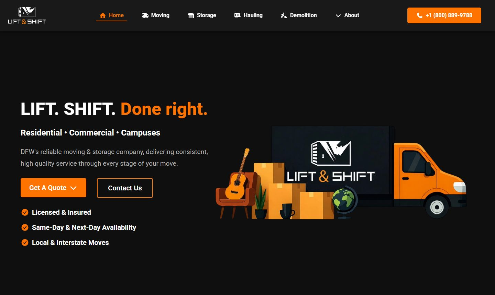
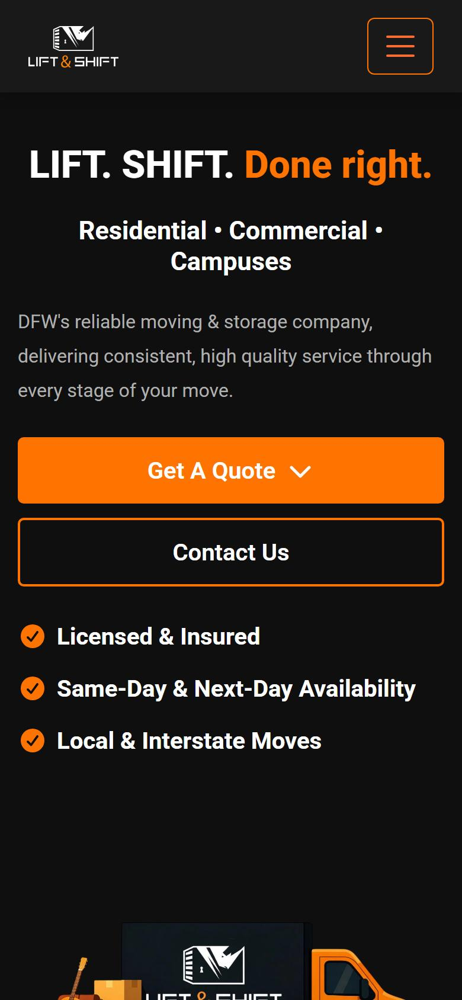

# Lift & Shift - company website

[](https://vuejs.org/)
[](https://vite.dev/)
[](https://getbootstrap.com/)
[](https://firebase.google.com/docs/hosting)

The website of **Lift & Shift**, a moving, storage, hauling and demolition company in Dallas-Fort Worth. It presents every service on its own page, with quote and contact forms, and works on phones as well as desktops.

**Live site:** https://liftshiftservices.com

<p align="center">
  
  &nbsp;
  
</p>

## Pages

| Route | Page |
|---|---|
| `/` | Home: hero, services overview, why choose us, call to action |
| `/moving` | Moving services and pricing plans |
| `/storage` | Storage services |
| `/hauling` | Hauling services |
| `/demolition` | Demolition services |
| `/aboutUs` | About the company |
| `/careers` | Careers page with a form |
| `/contact` | Contact form and company details |

## Tech stack

| Area | Tools |
|---|---|
| Framework | Vue 3 single-file components, Vue Router 4 |
| Build | Vite 7 |
| UI | Bootstrap 5, Font Awesome, custom CSS |
| Hosting | Firebase Hosting with SPA rewrites to `index.html` |
| Code style | Prettier |

## Project structure

```text
public/assets/        CSS, fonts, images and vendor scripts
src/
  views/              one view per route (Home, Moving, Storage, Hauling, ...)
  components/         page sections and forms, grouped by page
    Home/             hero, services, why-choose-us and call-to-action sections
    Shared/           navbar and footer
  router/             route table
  App.vue             layout shell
```

## Run it locally

Requires Node.js 20.19+ or 22.12+.

```bash
npm install
npm run dev        # start the dev server
npm run build      # production build in dist/
npm run preview    # serve the production build locally
```

## Deploy

The production build is served by Firebase Hosting (`firebase.json` serves `dist/` and rewrites every route to `index.html`, so client-side routes work on refresh).

```bash
npm run build
firebase deploy --only hosting
```

## Author

Built by [Hosam Ayoub](https://github.com/HosamAyoub).
